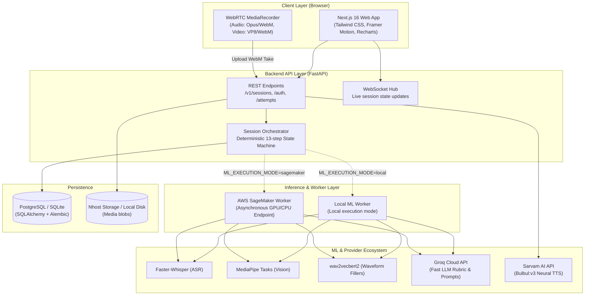

<div align="center">

# Pitchground

**Adaptive Multimodal Communication Training Under Pressure**

*Diagnose where your speech breaks. Train the exact condition until it is fixed.*

[](https://nextjs.org/)
[](https://react.dev/)
[](https://fastapi.tiangolo.com/)
[](https://python.org/)
[](https://github.com/SYSTRAN/faster-whisper)
[](https://developers.google.com/mediapipe)
[](https://aws.amazon.com/sagemaker/)
[](https://groq.com/)
[](https://www.postgresql.org/)

---

[Overview](#-overview) •
[Practice Modes](#-practice-modes) •
[Multimodal ML Engine](#-multimodal-ml-engine) •
[Architecture](#-system-architecture) •
[Getting Started](#-getting-started) •
[Configuration](#-configuration) •
[Deployment](#-cloud-deployment-hybrid) •
[Documentation](#-documentation-index)

---

</div>

## 📌 Overview

**Pitchground** is an adaptive communication training platform engineered to analyze, diagnose, and strengthen human communication performance under high-stakes pressure.

Traditional interview preparation platforms grade memorized answers with static LLM text prompts. Pitchground takes an entirely different approach:
- **Baseline Calibration:** Captures an unpressured baseline take to establish an individual's personal speaking signature.
- **Controlled Pressure Induction:** Introduces real-world stressors—tight countdown timers, unexpected interruptions, and aggressive rebuttals.
- **Multimodal Deterioration Analysis:** Quantifies shifts ($z$-deltas) across computer vision, acoustic prosody, verbatim transcription, and semantic content.
- **Targeted Diagnostic & Challenge:** Detects exact failure conditions (e.g. *freeze*, *fluency breakdown*, *ramble*, *delivery collapse*) and generates an adaptive, comparable retry challenge to train recovery.

> [!IMPORTANT]
> **Zero-Mock Engineering Principle:** Pitchground contains **no synthetic, mock, or hardcoded scoring numbers** in its ML pipelines. Every acoustic, visual, and disfluency metric is extracted dynamically from live video and audio streams. If lighting, audio quality, or camera visibility is inadequate, metrics are surfaced as *unavailable* rather than fabricated.

---

## 🎯 Practice Modes

Pitchground delivers five targeted, high-fidelity practice environments:

```
┌─────────────────────────────────────────────────────────────────────────────┐
│                             PITCHGROUND SUITE                               │
├───────────────────┬───────────────────┬─────────────────────────────────────┤
│ 🎙️ Adaptive       │ ⚔️ AI Debate       │ ⚡ Impromptu Speaking                │
│    Interview      │    Arena          │    10s prep, spontaneous topics,    │
│    Baseline →     │    Live voice AI  │    temporal fluency decay           │
│    pressure →     │    opponent via   │    timeline                         │
│    diagnosis →    │    Sarvam TTS &   │                                     │
│    targeted retry │    turn analysis  │                                     │
├───────────────────┴───────────────────┴─────────────────────────────────────┤
│ 🌐 Language Diagnostic                │ 🛡️ Recovery Training                │
│    Cross-lingual comparison isolating │    Mid-sentence interruption shock, │
│    subject knowledge from English     │    measuring vocal recovery latency │
│    articulation friction              │    and post-interruption composure  │
└───────────────────────────────────────┴─────────────────────────────────────┘
```

### 1. 🎙️ Adaptive Technical Interview (`/interview`)
A deterministic 13-step state-machine loop:
- **Phase 1 (Baseline):** Unpressured answer to establish acoustic and visual baseline vectors.
- **Phase 2 (Pressure):** Controlled stress injection (20-45s tight timers, cognitive interruptions).
- **Phase 3 (Diagnosis):** Multimodal delta comparison triggering automated failure classification.
- **Phase 4 (Targeted Challenge):** Adaptive retry on the same rubric with focused coaching cues.
- **Phase 5 (Progress Update):** Long-term Exponential Moving Average (EMA) skill tracking.

### 2. ⚔️ AI Debate Arena (`/debate`)
A 3-turn interactive sparring arena (Opening $\rightarrow$ Rebuttal $\rightarrow$ Closing):
- Opponent arguments synthesized in real-time with authentic regional voices using **Sarvam AI TTS** (`bulbul:v3`).
- Audio/video capture per turn with live counters, refutation strength analysis, and delivery grading.

### 3. ⚡ Impromptu Speaking (`/impromptu`)
Spontaneous speaking drill against unfamiliar prompts:
- Bounded 10-second preparation countdown.
- Windowed time-slice analysis tracking **Words Per Minute (WPM)**, pause ratios, and filler accumulation across the speech duration to diagnose *fluency decay*.

### 4. 🌐 Language Diagnostic (`/language-diagnostic`)
Isolates communication friction from subject-matter competence:
- The learner answers the **same technical question twice**—once in their native / comfortable language (e.g., Hindi or Malayalam) and once in professional English.
- Compares semantic concept coverage against acoustic pacing to identify whether hesitation stems from conceptual gaps or language retrieval friction.

### 5. 🛡️ Recovery Training (`/recovery-training`)
Trains cognitive resilience under disruptive conditions:
- The learner is unexpectedly interrupted mid-response.
- Measures the exact **recovery latency** (millisecond delay to first coherent post-interruption word) and compares pre- vs. post-interruption vocal prosody and composure.

---

## 🔬 Multimodal ML Engine

The backend ML pipeline (`backend/app/ml/`) integrates four specialized modalities without external black-box scoring APIs:

```
Media Input (WebM Audio / Video)
    │
    ├──► 🎙️ Faster-Whisper (small, CPU int8) ──► Verbatim STT & Word Timestamps
    │         └──► Lexical Disfluency Parser ──► Natural Fillers ("um", "uh", "matlab", "like")
    │
    ├──► 🌊 wav2vecbert2 Safetensors ──────────► Acoustic Waveform Filled-Pause Classifier
    │         └──► 20ms Frame Event Merger   ──► Direct Audio Disfluency Detection
    │
    ├──► 📊 PyAV / Librosa / Silero VAD ───────► Acoustic Prosody
    │         └──► Total WPM, Articulation WPM, Silence Ratio, Pause Count, Pitch Var
    │
    ├──► 👁️ MediaPipe Tasks (Face, Pose, Hands)► Computer Vision Signals
    │         └──► Iris Gaze Vector, Head Tilt, Posture Freeze Ratio, Hand Gestures
    │
    └──► 🧠 Bounded Groq LLM Evaluation ──────► Content Signals
              └──► Factual Coverage, Rubric Adherence, Relevance, Illustrative Answer
```

### Signal Specifications

| Modality | Extractor | Metrics Extracted |
|---|---|---|
| **Verbatim Speech** | Faster-Whisper (`small`, int8) | Exact timestamped words, disfluencies, unedited speech tokens, language detection. |
| **Acoustic Fillers** | `classla/wav2vecbert2-filledPause` | Waveform-level classification of non-lexical vocalized pauses (independent of ASR). |
| **Prosody & Voice** | Librosa + PyAV + Silero VAD | Total WPM, articulation WPM (voiced speech only), pause ratio, $\ge 700\text{ms}$ pause bursts, pitch variance ($\text{std}(f_0)$), energy variance. |
| **Visual Presence** | MediaPipe Face Mesh & Iris | Camera gaze deviation, horizontal/vertical head tilt angles. |
| **Posture & Hands** | MediaPipe Pose & Hand Landmarks | Upper-body stillness/freeze ratio, handedness-matched gesture energy. |
| **Semantic Content** | Groq (`gpt-oss-120b` / role models) | Key-point rubric coverage, technical relevance, depth score, illustrative answer comparison. |

### Diagnostic Classification Matrix

When an attempt under pressure deviates significantly from the baseline vector ($z\text{-delta} \ge \theta$), the system classifies the deterioration into canonical failure conditions:

- `freeze`: Sudden cessation of speech with high upper-body visual stillness.
- `fluency_breakdown`: Spike in filler density, burst pauses, and fragmented pacing.
- `language_instability`: Involuntary code-switching bursts or lexical retrieval blocks.
- `knowledge_gap`: Normal delivery/pace but low rubric key-point coverage.
- `delivery_collapse`: Gaze aversion, head drop, and loss of vocal projection.
- `ramble`: Runaway utterance duration with deteriorating semantic information density.

---

## 🏗️ System Architecture

Pitchground combines a high-performance **Next.js** frontend with an asynchronous **FastAPI** backend, supporting both zero-dependency local execution and hybrid cloud deployment.



---

## 📁 Repository Structure

```
pitchground/
├── frontend/                  # Next.js 16 App Router frontend
│   ├── app/                   # App Router pages (/interview, /debate, /impromptu, etc.)
│   ├── components/            # UI, dashboard, shared, and modal components
│   ├── lib/                   # API clients, signal mappers, types, auth utilities
│   ├── services/              # Client-side domain services (practice, session, debate)
│   └── public/                # Static brand assets and fonts
│
├── backend/                   # FastAPI backend & multimodal ML services
│   ├── alembic/               # Database migrations (001_initial, 002_session, 003_topics)
│   ├── app/
│   │   ├── agents/            # LLM interviewer, diagnosis, challenge agents
│   │   ├── api/               # REST routes (auth, sessions, media) and WebSockets
│   │   ├── ml/                # Isolated ML engine (Whisper, MediaPipe, Librosa, wav2vec)
│   │   ├── models/            # SQLAlchemy database entities (User, Learner, Session, Attempt)
│   │   ├── orchestration/     # Deterministic state machine & training engine
│   │   ├── repositories/      # Data access layer
│   │   ├── schemas/           # Pydantic v2 validation contracts
│   │   ├── services/          # Baselines, metrics verification, practice reports
│   │   └── storage/           # Local filesystem and Nhost S3 storage adapters
│   ├── tests/                 # Full test suite (unit, integration, ML accuracy)
│   ├── Dockerfile.sagemaker   # Production container for AWS SageMaker async inference
│   ├── download_vision_models.py # Downloads MediaPipe task assets
│   ├── download_speech_model.py  # Downloads Faster-Whisper small multilingual model
│   └── download_filler_model.py  # Downloads wav2vecbert2 filled-pause classifier
│
├── deploy/                    # Infrastructure-as-Code & deployment configurations
│   └── sagemaker/             # AWS SageMaker endpoint provisioning & IAM policies
│
└── docs/                      # Architectural specs, API schemas, and deployment guides
    ├── ARCHITECTURE.md        # Deep architectural design and lifecycle states
    ├── API.md                 # REST & WebSocket contract specifications
    ├── ML_ARCHITECTURE_AND_SPECIFICATION.md # In-depth ML model & feature formulas
    ├── ML_CONTRACTS.md        # Typed schema boundaries for multimodal signals
    ├── SAGEMAKER_DEPLOY.md    # Render + SageMaker production setup guide
    └── IMPROVEMENT_CHECKLIST.md # Audit log, model validation, and verified fixes
```

---

## 🚀 Getting Started

### Prerequisites

- **Node.js**: `v18.17.0+` (v20+ recommended)
- **Python**: `3.11.x` (strictly recommended for PyAV and MediaPipe compatibility)
- **FFmpeg**: Installed and available in your system `$PATH`

---

### 1. Backend Setup

```bash
# Navigate to the backend directory
cd backend

# Create and activate a Python 3.11 virtual environment
python3 -m venv .venv
source .venv/bin/activate  # On Windows: .venv\Scripts\activate

# Install all runtime and local ML dependencies
pip install -r requirements.txt

# Download required offline ML model weights
python download_vision_models.py
python download_speech_model.py
python download_filler_model.py

# Configure your environment variables
cp .env.example .env
# Edit .env to set your JWT_SECRET, GROQ_API_KEY, and optional credentials

# Apply database migrations (SQLite by default, or PostgreSQL)
alembic upgrade head

# Start the development server
uvicorn app.main:app --reload --port 8000
```

The API will be available at `http://localhost:8000`. Test liveness via:
```bash
curl http://localhost:8000/health
```

---

### 2. Frontend Setup

```bash
# Navigate to the frontend directory
cd frontend

# Install npm dependencies
npm install

# Configure local environment
cat << EOF > .env.local
NEXT_PUBLIC_API_URL=http://localhost:8000
EOF

# Start the Next.js development server
npm run dev
```

Open [http://localhost:3000](http://localhost:3000) in your browser.

> [!TIP]
> **Guest Demo Mode:** If you do not have Google OAuth set up locally, set `DEMO_AUTH=1` in `backend/.env`. You can click **"Continue as Guest"** on the login screen to instantiate an isolated, authenticated session without OAuth.

---

## ⚙️ Configuration

Key environment variables in `backend/.env`:

| Variable | Default | Purpose |
|---|---|---|
| `JWT_SECRET` | *(required)* | Secret key for signing user session tokens. |
| `FRONTEND_URL` | `http://localhost:3000` | Frontend web origin for CORS and OAuth redirects. |
| `BACKEND_URL` | `http://localhost:8000` | Public backend URL. |
| `DATABASE_URL` | `sqlite:///./data/pitchground.db` | PostgreSQL or SQLite connection string. |
| `STORAGE_BACKEND` | `local` | `local` (disk under `data/media/`) or `nhost` (S3). |
| `GROQ_API_KEY` | *(recommended)* | API key for Groq Cloud ultra-fast inference. |
| `GROQ_MODEL` | `openai/gpt-oss-120b` | Base model for question generation and answer review. |
| `SARVAM_API_KEY` | *(optional)* | Key for Sarvam AI neural TTS used in debate arena. |
| `SARVAM_TTS_MODEL` | `bulbul:v3` | Sarvam TTS model identifier. |
| `ML_ANALYZER` | `real` | Always set to `real` for full multimodal inference. |
| `ML_EXECUTION_MODE` | `local` | `local` (in-process ML) or `sagemaker` (AWS endpoint). |
| `WHISPER_MODEL` | `small` | Faster-Whisper model size (`small`, `medium`). |
| `WHISPER_CPU_THREADS` | `4` | Number of CPU threads allocated to transcription. |

---

## ☁️ Cloud Deployment (Hybrid)

Pitchground is designed for optimal cost and performance using a **split architecture**:

- **Frontend:** Deployed to **Vercel** with automatic preview deployments and edge routing.
- **Backend API:** Deployed to **Render** (512 MB lightweight instance) running `requirements-api.txt`.
- **Heavy Multimodal ML:** Containerized on **AWS SageMaker Asynchronous Endpoints** via `Dockerfile.sagemaker`.
  - Automatically scales to zero instances when idle to eliminate compute costs.
  - Wakes up dynamically upon job enqueue.
- **Database & Media:** Managed **Nhost PostgreSQL** and S3-compatible cloud storage.

For detailed deployment runbooks, see:
- [AWS SageMaker Deployment Guide](docs/SAGEMAKER_DEPLOY.md)
- [Nhost Database & Storage Setup](docs/NHOST_SETUP.md)
- [General Cloud Matrix](docs/DEPLOY.md)

---

## 🧪 Verification & Testing

Pitchground includes a comprehensive verification suite:

```bash
# Run backend integrity, LLM routing, and schema tests
cd backend
pytest tests/test_product_integrity.py tests/test_llm_routing.py -q

# Run local ML unit tests (synthetic audio & video frames)
python tests/test_local_ml.py

# Run verbatim speech & filler accuracy benchmarks
python tests/test_phase2_stt.py

# Run frontend TypeScript validation
cd ../frontend
npx tsc --noEmit
```

---

## 📚 Documentation Index

For deep dives into design choices, technical contracts, and implementation specifications:

- [System Architecture & Lifecycle](docs/ARCHITECTURE.md) — 13-step state machine, phase transitions, and service boundaries.
- [ML Architecture & Technical Specification](docs/ML_ARCHITECTURE_AND_SPECIFICATION.md) — Mathematical formulas, model choices, and signal extraction logic.
- [ML Signal Contracts](docs/ML_CONTRACTS.md) — Typed data structures for acoustic, visual, language, and content payloads.
- [API Reference](docs/API.md) — Complete REST and WebSocket payload contracts.
- [Improvement & Audit Checklist](docs/IMPROVEMENT_CHECKLIST.md) — Full historical audit of real-world model integrations.
- [AWS SageMaker Infrastructure](docs/SAGEMAKER_DEPLOY.md) — Cloud ML worker deployment and autoscaling.

---

## 🛡️ License & Team Notes

This project was built for high-stakes communication mastery. All models used—Faster-Whisper, MediaPipe Tasks, and wav2vecbert2-filledPause—comply with their respective open-source licenses (MIT, Apache-2.0).

*Built with precision for confident, articulate communication.*
